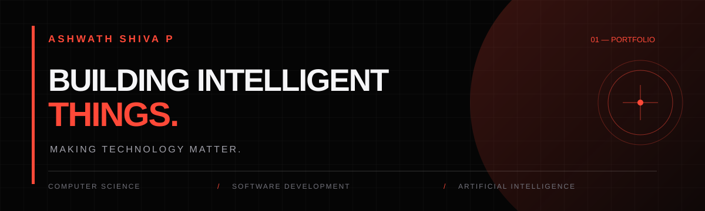

# ASHWATH SHIVA P

### BUILDING INTELLIGENT THINGS.  
**MAKING TECHNOLOGY MATTER.**

Computer Science and Engineering student focused on software development, artificial intelligence, and building practical digital experiences.

[**EXPLORE MY PORTFOLIO →**](https://ashwathshiva.github.io/portfolio/)

---

## 01 / ABOUT

I'm a Computer Science and Engineering student at Vimal Jyothi Engineering College, interested in building thoughtful software solutions and solving problems through technology.

I enjoy exploring new technologies, developing applications, and turning ideas into functional projects.

- 🎓 Computer Science and Engineering
- 💻 Interested in Software Development and AI
- 🧠 Exploring RAG architectures and LLM applications
- 🛠️ Learning through practical projects and experimentation

---

## 02 / TECHNICAL CAPABILITIES

**Programming & Development**

Python · C · JavaScript 

**AI & Machine Learning**

RAG Architectures · Prompt Engineering

**Databases & Infrastructure**

PostgreSQL · Supabase · Qdrant · Git · GitHub · Docker

---

## 03 / SELECTED PROJECTS

### 01 — KTU AI
**RAG-BASED INTELLIGENT ACADEMIC ASSISTANT**

An AI-powered academic assistant designed to help KTU students access syllabus-grounded answers, understand concepts, explore previous-year questions, and practise academic topics.

**Technologies:** React · TypeScript · FastAPI · PostgreSQL · Supabase · Qdrant

[Explore Portfolio →](https://ashwathshiva.github.io/portfolio/)

### 02 — URBAN SOUND CLASSIFICATION
**MACHINE LEARNING / AUDIO CLASSIFICATION**

A machine learning project that explores environmental sound classification using audio feature extraction and convolutional neural networks.

**Technologies:** Python · PyTorch · Librosa · UrbanSound8K

[Explore Portfolio →](https://ashwathshiva.github.io/portfolio/)

### 03 — WHO_CARES?
**HACKATHON PROJECT · TINKERHUB USELESS PROJECTS 3.0**

An unconventional human-evaluation platform that turns everyday interactions into a satirical experience through profiles, ratings, global rankings, and entertaining evaluation reports.

**Technologies:** React · JavaScript · Vite · Tailwind CSS · Web Crypto API

[View Repository →](https://github.com/ashwathshiva/who_cares)

---

## 04 / CURRENTLY EXPLORING

- Retrieval-Augmented Generation and LLM applications
- Building practical AI-powered software
- Full-stack application development
- Better software architecture and engineering practices

---

## 05 / GITHUB ACTIVITY

---

## 06 / CONNECT

[**PORTFOLIO ↗**](https://ashwathshiva.github.io/portfolio/) · [**GITHUB ↗**](https://github.com/ashwathshiva)

---

*ALWAYS LEARNING. ALWAYS BUILDING.*
